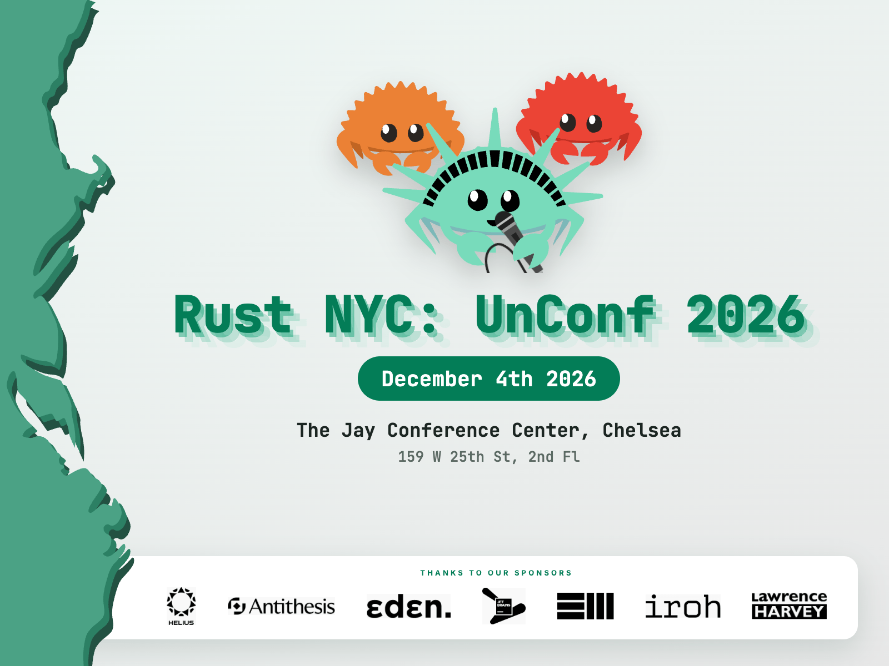

#  Rust NYC!

<section class="unconf-callout" aria-labelledby="unconf-title">
  
  <h2 id="unconf-title">Rust NYC: The UnConf 2026</h2>
  <p><strong>Friday, December 4, 2026 · 2–6 PM EST</strong><br>
  Jay Conference Center, Chelsea<br>
  159 West 25th Street, 2nd floor, New York, NY</p>
  <p>Join us for a free afternoon of 20 interactive tracks: discussions, workshops, talks, demos, and classes covering embedded Rust, async, distributed systems, AI, GPUs, databases, and more. Stay for happy hour afterwards!</p>
  <p>Space is limited to 300 attendees. Registration requires approval, and we’ll bring people off the waitlist weekly.</p>
  <a class="unconf-callout__button" href="https://luma.com/fkm536ya">Register for free on Luma</a>
  <p class="unconf-callout__details">See the announced tracks and latest event details on <a href="/unconf/">the event page</a>.</p>
</section>

<aside class="talk-callout">
  <h2>Share your Rust story</h2>
  <p>Have an idea you'd like to share at a future meetup? Send us a talk proposal.</p>
  <a class="talk-callout__button" href="https://rustnyc-talks.val.run/">Submit a talk</a>
</aside>

## Meetup

 - [Meetup events](https://www.meetup.com/Rust-NYC/)
 - [Join the Discord](https://discord.gg/5mGe3AGzgn) (#in-nyc)

Follow us on [Bluesky](https://bsky.app/profile/rust.nyc), [𝕏](https://x.com/rust_nyc), and [YouTube](https://youtube.com/@RustEastCoast)

[Source code of this website](https://github.com/rust-nyc/rust-nyc.github.io)

## Rust East Coast

Rust NYC is a part of the Rust East Coast group (organized on Discord) that shares resources with communities from other cities.
[Rust East Coast links](https://rusteastcoast.com?utm_source=rust.nyc)

## Resources

- [Rust Lang book](https://rust-lang.github.io/book/)

## Exercises

- [exercism](http://exercism.io/languages/rust)
- [rustlings](https://github.com/rust-lang/rustlings)

### Rust NYC curated exercises

#### File exercise!

Download this file: [big.txt](http://norvig.com/big.txt)

1. Calculate number of bytes in file
2. Number of occurrences of the letter 'z' in file
3. Number of occurrences of all letters (case insensitive) in file

How does performance compare to this Python script version?

```python
file_ = open("big.txt")
count = 0
for line in file_:
    for char in line:
        count += 1
print(count)
```
