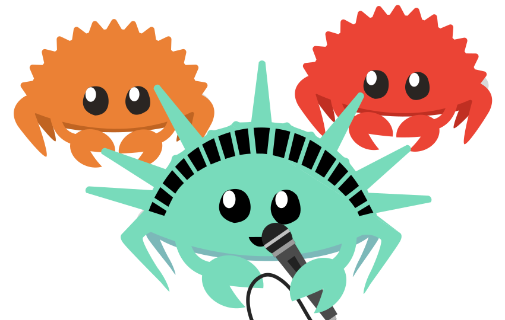

#  Rust NYC!

<section class="unconf-callout" aria-labelledby="unconf-title">
  
  <h2 id="unconf-title">Rust NYC: UnConf 2026</h2>
  <p class="unconf-callout__date"><strong>December 4, 2026 · 2–6 PM EST</strong></p>
  <p>A free afternoon of 20 interactive Rust tracks, followed by happy hour.</p>
  <a class="unconf-callout__button" href="https://luma.com/fkm536ya">Details &amp; free registration</a>
  <div class="unconf-sponsors" aria-labelledby="sponsors-title">
    <h3 id="sponsors-title">Thanks to our sponsors</h3>
    <div class="unconf-sponsors__logos">
      
      
      
      
      
      
      
    </div>
  </div>
</section>

<aside class="talk-callout">
  <h2>Share your Rust story</h2>
  <p>Have an idea you'd like to share at a future meetup? Send us a talk proposal.</p>
  <a class="talk-callout__button" href="https://rustnyc-talks.val.run/">Submit a talk</a>
</aside>

## Meetup

 - [Meetup events](https://www.meetup.com/Rust-NYC/)
 - [Join the Discord](https://discord.gg/5mGe3AGzgn) (#in-nyc)

Follow us on [Bluesky](https://bsky.app/profile/rust.nyc), [𝕏](https://x.com/rust_nyc), and [YouTube](https://youtube.com/@RustEastCoast)

[Source code of this website](https://github.com/rust-nyc/rust-nyc.github.io)

## Rust East Coast

Rust NYC is a part of the Rust East Coast group (organized on Discord) that shares resources with communities from other cities.
[Rust East Coast links](https://rusteastcoast.com?utm_source=rust.nyc)

## Resources

- [Rust Lang book](https://rust-lang.github.io/book/)

## Exercises

- [exercism](http://exercism.io/languages/rust)
- [rustlings](https://github.com/rust-lang/rustlings)

### Rust NYC curated exercises

#### File exercise!

Download this file: [big.txt](http://norvig.com/big.txt)

1. Calculate number of bytes in file
2. Number of occurrences of the letter 'z' in file
3. Number of occurrences of all letters (case insensitive) in file

How does performance compare to this Python script version?

```python
file_ = open("big.txt")
count = 0
for line in file_:
    for char in line:
        count += 1
print(count)
```
